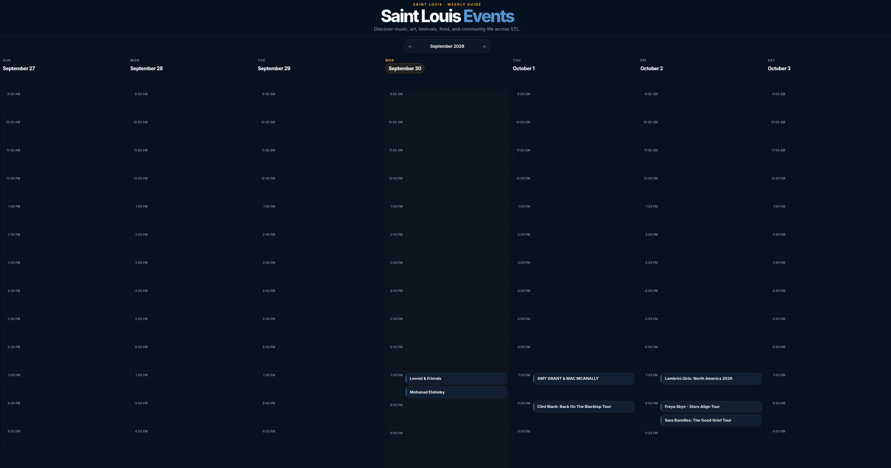

[](https://github.com/mcckyle/the-calendar/actions/workflows/main.yml)
[](./LICENSE)
# Saint Louis Events

A modern, accessible weekly events calendar for discovering what's happening across Saint Louis.

The project provides a focused calendar interface for browsing local events by day and time.

**Live application:** https://mcckyle.github.io/the-calendar/

> **Status:** Active development

## Overview

Saint Louis Events is designed around a simple idea: make local events easier to discover.

The calendar presents a full-week view with events organized by day and time. Users can move between weeks and open individual events for additional information such as locations and links to the original event listing.

Event data is supplied by the project's Spring Boot backend, which securely communicates with the Ticketmaster Discovery API.

## Features

- **Weekly calendar** - Browse a complete seven-day view of Saint Louis events.
- **Week navigation** - Move forward and backward through available weeks.
- **Time-based organization** - Events are grouped into hourly calendar slots.
- **Event details** - Open an event to view its date, time, description, venue, and external link.
- **Accessible interactions** - Uses semantic HTML, keyboard interaction, focus management, ARIA labeling, and reduced-motion support. 
- **Client-side caching** - Recently requested weeks are retained in memory to reduce unnecessary requests.
- **Adjacent-week prefetching** - Neighboring weeks are prefetched to make navigation feel immediate.
- **Server-side caching** - The backend caches Ticketmaster responses before they reach the frontend.

## Screenshots


  
## Technology

| Layer | Technology |
| --- | --- |
| UI | [React](https://react.dev/) |
| Build tool | [Vite](https://vite.dev/) |
| Styling | CSS |
| Data source | Ticketmaster Discovery API |
| Backend | Spring Boot |
| Backend cache | Caffeine |
| Testing | Vitest / React Testing Library |

## Architecture

The frontend does not communicate directly with Ticketmaster.

```text
┌─────────────────────────┐
│   Saint Louis Events    │
│      React / Vite       │
└────────────┬────────────┘
             │
             │ GET /api/events
             ▼
┌─────────────────────────┐
│    Spring Boot API      │
│      Event Proxy        │
└────────────┬────────────┘
             │
             │ Cached request
             ▼
┌─────────────────────────┐
│ Ticketmaster Discovery  │
│          API            │
└─────────────────────────┘
```

This keeps the Ticketmaster API key on the server rather than exposing it in the browser.

The backend repository is available at: https://github.com/mcckyle/calendar-backend

## Installation

To get the project running locally, follow these steps:

1. Clone the repository:
   ```bash
   git clone https://github.com/mcckyle/the-calendar.git
   ```

2. Navigate into the project directory:
   ```bash
   cd the-calendar
   ```

3. Install the dependencies:
   ```bash
   npm install
   ```

4. Run the development server:
   ```bash
   npm run dev
   ```

The calendar will go live at `http://localhost:5173/the-calendar/`.
   
## Project Structure

```
the-calendar/
├── .git/                  # Git version control directory.
├── .github/               
│   └── workflows/
│       └── main.yml
│
├── public/                # Demo screenshots folder.
│   └── images/
│
├── src/                   # Source code for the React app.
│   ├── components/        # Reusable UI components.
│   │   ├── Calendar/
│   │   │   ├── Calendar.jsx
│   │   │   ├── Calendar.css
│   │   │   └── CalendarContext.jsx
│   │   │
│   │   ├── WeekNavigation/
│   │   │   ├── WeekNavigation.jsx
│   │   │   └── WeekNavigation.css
│   │   │
│   │   ├── DaysOfWeek/
│   │   │   ├── DaysOfWeek.jsx
│   │   │   └── DaysOfWeek.css
│   │   │
│   │   ├── WeekDayColumn/
│   │   │   ├── WeekDayColumn.jsx
│   │   │   └── WeekDayColumn.css
│   │   │
│   │   ├── TimeSlot/
│   │   │   ├── TimeSlot.jsx
│   │   │   └── TimeSlot.css
│   │   │ 
│   │   ├── EventChip/
│   │   │   ├── EventChip.jsx
│   │   │   └── EventChip.css
│   │   │
│   │   ├── EventPanel/
│   │   │   ├── EventPanel.jsx
│   │   │   └── EventPanel.css
│   │   │
│   │   └── EventCard/
│   │       ├── EventCard.jsx
│   │       └── EventCard.css
│   │
│   ├── data/              # events.json data.
│   ├── hooks/             # Custom hooks and API call.
│   ├── utils/             # Calendar formatting helper functions.
│   ├── App.jsx
│   ├── App.css
│   ├── main.jsx
│   └── index.css          # Global styles.
│
├── __tests__/             # Unit tests.
│   ├── Calendar.test.jsx
│   ├── CalendarContext.test.jsx
│   ├── WeekNavigation.test.jsx
│   ├── DaysOfWeek.test.jsx
│   ├── WeekDayColumn.test.jsx
│   ├── TimeSlot.test.jsx
│   ├── EventPanel.test.jsx
│   └── EventCard.test.jsx
│
├── .gitignore            # Files and directories to ignore in Git.
├── eslint.config.js
├── vite.config.js
├── index.html
├── package-lock.json
├── package.json          # Project metadata and dependencies.
├── LICENSE
└── README.md             # Project documentation.
```

## Design Principles

The interface is intentionally centered around a few principles:

- **Clarity** - Events should be understandable at a glance.
- **Accessibility** - The calendar should remain usable with keyboards and assistive technology.
- **Responsiveness** - The calendar should remain useful across viewport sizes.
- **Performance** - Cached and prefetched event data should make navigation feel immediate.

## Development

The project uses component-level organization to keep calendar functionality isolated and maintainable.

Calendar behavior is separated from presentation where practical:

- `Calendar` coordinates the weekly view.
- `WeekNavigation` controls week changes.
- `DaysOfWeek` provides the calendar header.
- `WeekDayColumn` renders each day.
- `TimeSlot` represents an individual hour.
- `EventChip` provides the compact event information.
- `EventPanel` displays detailed event information.
- `EventCard` presents the selected event.

## Roadmap

Future development may include:

- Expanded event sources beyond Ticketmaster.
- Improved event discovery and filtering.
- Additional calendar views.
- More refined mobile interactions.
- User-oriented event features.

The roadmap is intentionally flexible as the project evolves.

## Contributing

This project is open-source and actively welcomes contributions. Here's how you can get involved:

1. Fork the repository.
2. Create a focused feature or fix branch.
3. Make and test your changes.
4. Commit with a clear message.
5. Open a pull request describing the change.

For smaller ideas or potential bugs, opening an issue is also welcome.

## License

Saint Louis Events is available under the [MIT LICENSE](./LICENSE).

## Acknowledgements

- **React**: A JavaScript library for building user interfaces. Special thanks to the React team for creating such a powerful and flexible tool.
- **Vite**: A next-generation build tool that provides fast development and optimized production builds. Thanks to the Vite team for their excellent tool.
- **CSS Grid & Flexbox**: Thank you to the CSS working group for developing these modern layout techniques that allowed for a responsive and user-friendly design.
- **Open Source Community**: A huge thank you to the open-source community for providing numerous resources, tutorials, and libraries that made the development of this project much easier.
- **Saint Louis Community**: Special thanks to the vibrant Saint Louis community for inspiring the creation of this calendar, and for providing a wealth of cultural and community events that enabled the project and its content.
